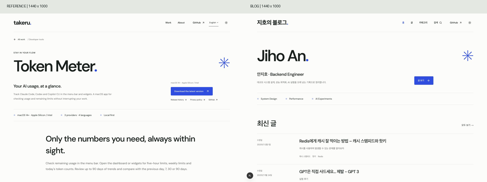
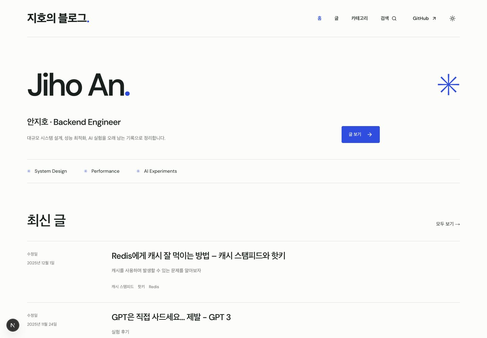
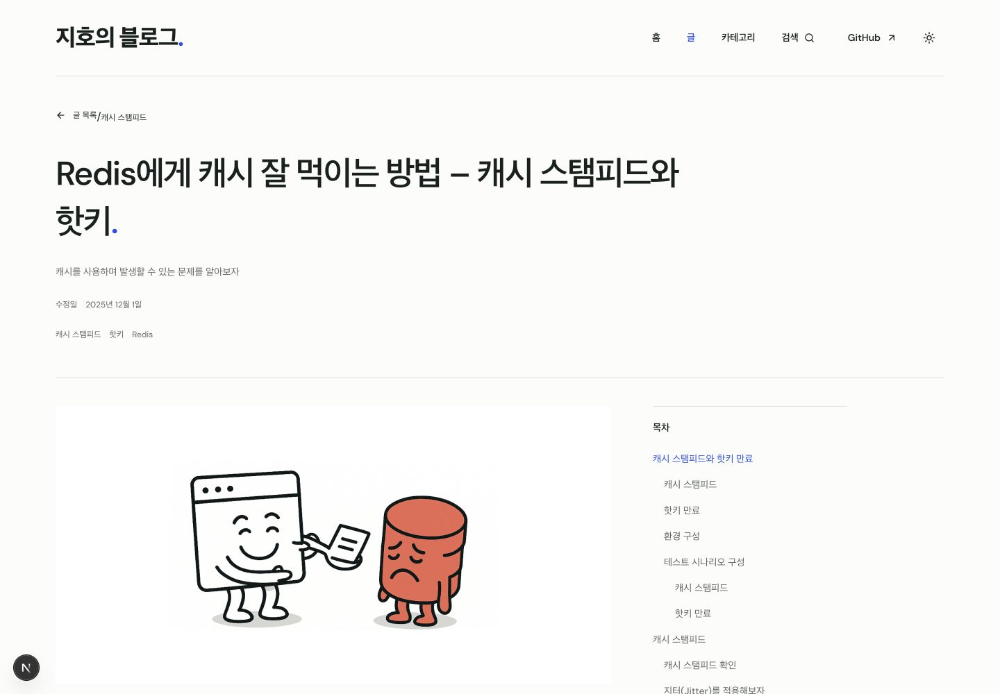
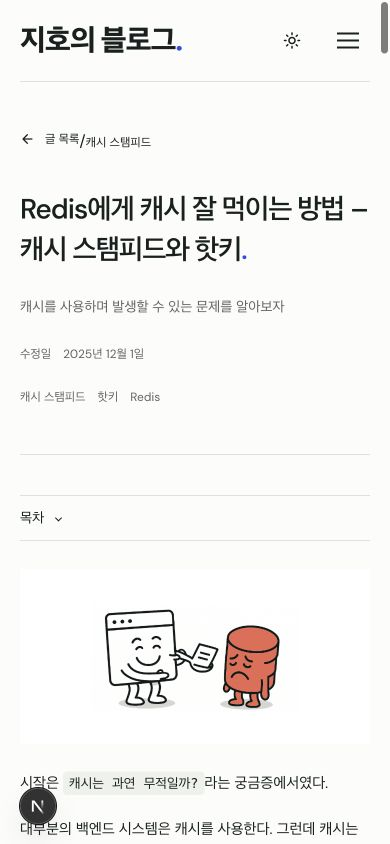

# 블로그 디자인 시스템 적용 결과

검증일: 2026-10-15 · 작업 브랜치: `feature/token-meter-replica`

기준 문서: [디자인 시스템](DESIGN-SYSTEM.md), [화면별 설계](BLOG-SCREENS.md)  
브라우저 미리보기: http://127.0.0.1:3000/

## 적용 범위

기존 게시글, 카테고리, 경로와 검색·정렬·페이지 이동 로직을 유지하면서 공통 시각 체계를 적용했다. `posts`, `lib`, `data`에는 변경이 없다.

- 메인: 큰 이름 제목, 파란 별표와 CTA, 최신 글 5개, 실제 카테고리 목록.
- 게시글 목록·검색: 테두리로 구분하는 글 행, 검색 필드, 카테고리 필터, 정렬, 결과 수, 페이지 이동과 빈 결과 안내.
- 카테고리: 이름·글 수·화살표를 사용한 행과 기존 카테고리별 글 목록.
- 상세: 본문 최대 800px, 제목·날짜·태그, Markdown 스타일, 코드 복사, 실제 제목에서 생성하는 목차, 이전 글·다음 글.
- 모바일: 세로로 쌓는 행, 메뉴 펼침, 접이식 목차, 코드·표 내부 가로 스크롤.
- 공통: 레퍼런스의 밝은 배경과 파란 강조색, DM Sans, 작은 모서리, 가는 구분선, 파란 푸터, 원형 테마 전환.

## 재사용 구조

| 역할 | 구현 |
| --- | --- |
| 색상·폰트·크기·간격·반응형 토큰 | `app/design-tokens.css` |
| 공통 스타일과 Markdown 규칙 | `app/globals.css` |
| 페이지 틀 | `Container`, `SiteHeader`, `SiteFooter` |
| 페이지 제목·소개 | `PageIntro`, `HeroBio` |
| 글 목록 행 | `PostCard` (홈·목록·검색에서 공유) |
| 카테고리·태그 | `CategoryGrid`, `CategoryWidget`, `TagLinks` |
| 검색·페이지 이동 | `SearchField`, `Pagination`, `PostIndexShell` |
| 글 읽기 도구 | `MDXContent`, `CodeBlock`, `ArticleTOC`, `PostNavigation` |
| 아이콘·테마 | `Icon`, `ThemeSwitcher` |

기존 둥근 카드와 민트색 스타일을 정리했다. 기본 색은 의미 기반 토큰으로 관리하고, 페이지마다 별도 색상 체계를 만들지 않았다. 한국어는 승인된 시스템 폰트 대체 규칙을 사용한다. 본문용 고정폭 폰트와 푸터의 제한적인 Georgia 사용도 설계 문서를 따른다.

## 레퍼런스 비교

실제 레퍼런스와 블로그를 각각 **1440 × 1000** 화면에서 캡처하고 계산된 스타일을 확인했다.

| 항목 | 레퍼런스 | 블로그 |
| --- | --- | --- |
| 밝은 배경 | `#fcfdfb` | `#fcfdfb` |
| 기본 글자색 | `#17201e` | `#17201e` |
| 기본 파란색 | `#254ee8` | `#254ee8` |
| 헤더 최대 폭 / 높이 | 1280px / 110px | 1280px / 110px |
| 대표 제목 크기 / 굵기 | 93.6px / 550 | 93.6px / 550 |
| CTA 높이 / 모서리 | 50px / 4px | 50px / 4px |
| CTA 글자 크기 / 굵기 | 13px / 550 | 13px / 550 |
| 페이지 가로 넘침 | 없음 | 없음 |

내용과 화면 목적이 다르므로 픽셀 전체 일치를 목표로 삼지 않았다. 레퍼런스의 색상·서체·제목 비율·페이지 폭·구분선·버튼 형태를 유지하고, 글 목록과 읽기 화면은 승인된 블로그 설계에 맞게 확장했다.

검증 중에는 오래된 개발 스타일 캐시를 제거해 실제 새 토큰이 표시되도록 수정하고, 상세 페이지 카테고리와 태그의 중복 표시를 정리했다. 목차는 글 경로가 바뀔 때 새로 수집하고, 모바일 목차를 선택하면 메뉴가 닫히도록 구성했다. 부드러운 스크롤 사용도 페이지 루트에 명시했다.

원본 측정값: [reference-comparison.json](validation/reference-comparison.json)

## 확인 결과

| 범위 | 결과 |
| --- | --- |
| 메인 | 최신 글 5개와 카테고리 11개 표시 |
| 전체 글 | 기존 27개 글, 페이지당 8개 유지 |
| 검색 | Redis 검색 1개, 존재하지 않는 검색어 0개, 초기화 정상 |
| 정렬·페이지 이동 | 오래된 글 순 정렬, 2페이지 이동, 뒤로 가기 후 상태 복원 |
| 카테고리 | 전체 카테고리와 Redis 카테고리의 실제 글 표시 |
| 목차 | Redis 상세의 본문 제목 20개와 링크 20개 일치, 모바일 링크 이동·닫힘 확인 |
| 코드 복사 | 코드 원문과 클립보드 내용 일치, 완료 안내 표시 |
| 테마 | 다크 전환, 새로고침 후 선택 유지 |
| 반응형 | 1440 × 1000, 768 × 1024, 390 × 844 확인; 페이지 가로 넘침 없음 |
| 빌드 | `npm run build` 성공, 기존 경로를 포함한 82개 정적 경로 생성 |
| 코드 검사 | `eslint app components lib --ext js,mjs`, `git diff --check` 통과 |
| 콘텐츠 보존 | `git diff --exit-code -- posts lib data` 통과 |

테마 전환은 레퍼런스의 600ms 원형 확산을 사용하고, 동작 줄이기 설정에서는 효과를 생략한다. 새 장식용 진입 애니메이션은 추가하지 않았다.

## 최종 화면

추가 캡처: [글 목록](validation/posts-desktop.jpg), [검색](validation/search-desktop.jpg), [빈 검색](validation/search-empty.jpg), [카테고리](validation/categories-desktop.jpg), [코드 블록](validation/article-code-desktop.jpg), [모바일 메뉴](validation/mobile-menu.jpg), [모바일 목차](validation/article-mobile-toc.jpg), [다크 모드](validation/article-mobile-dark.jpg), [태블릿](validation/article-tablet.jpg).

캡처는 로컬 개발 서버에서 진행했다. 화면 왼쪽 아래의 Next.js 개발 표시기는 배포 결과에는 포함되지 않는다. 현재 변경은 로컬 작업 상태이며 배포하지 않았다.
