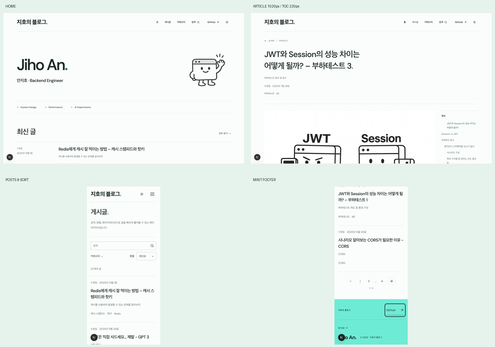

# 스크린샷 요청 8개 반영 결과

2026-10-15 · `feature/token-meter-replica`

| 요청 | 반영 내용 |
| --- | --- |
| 1. 별표·글 보기 버튼 → 캐릭터 | 기존 `public/logo.png`를 홈 우측에 배치. 두 컴포넌트를 제거하고 모바일에서도 캐릭터를 표시한다. 다크 모드에서는 선의 색을 반전해 가독성을 확보했다. |
| 2. 기존 초록색 복원 | 기존 프로젝트의 민트 `#0cefd3`를 강조 면·푸터에 사용. 배경·구분선·호버·다크 색도 초록 계열로 통일했다. 작은 링크에는 대비를 위해 짙은 초록 `#087568`을 사용한다. |
| 3. 큰 푸터 문구 삭제 | ‘기록을 오래 남기기.’ 제거. 비워진 배너 여백도 줄였다. |
| 4. 홈 소개 설명 삭제 | ‘대규모 시스템 설계, 성능 최적화, AI 실험을 오래 남는 기록으로 정리합니다.’ 제거. 이름과 역할은 유지했다. |
| 5. ‘글.’ 이름 변경 | 목록 제목과 내비게이션을 ‘게시글’로 통일했다. |
| 6. 정렬 화살표 배치 | 브라우저 기본 화살표 대신 선택 상자 내부 우측16px·높이 중앙에 고정한 화살표 사용. 오른쪽42px 패딩으로 글자와 겹치지 않게 했다. 네이티브 선택 기능은 유지한다. |
| 7. 목차 오른쪽 빈 공간 | 기존800px 본문+280px 목차+60px 간격=1140px여서1280px 영역 우측140px가 남았다. 본문을 유동 폭으로 바꿔 목차 오른쪽 끝이 전체 영역 끝과 일치하도록 했다. |
| 8. 목차 비율 축소 | 목차280→220px, 간격60→40px. 1440px 화면에서 본문800→1020px. 태블릿·모바일은 전체 가용 폭의 본문과 접이식 목차를 유지한다. |

명명 참고로 [토스 테크](https://toss.tech/)의 ‘전체 아티클’ 아카이브를 확인했다. 내용을 담는 목록이라는 뜻이 분명하도록 이 블로그에서는 한국어 ‘게시글’을 선택했다. 해당 사이트의 레이아웃을 새로 적용한 것은 아니다.

첨부 민트 스와치는 색상 프로파일을 sRGB로 변환하면 약 `#0defd3`이며, 기존 코드의 `#0cefd3`와 반올림 수준의 차이다. 기존 코드 값을 그대로 복원했다.

## 검증

- 1440×900,768×1024,390×844에서 홈·게시글 목록·JWT/Session 상세를 실제 브라우저로 확인하고 캡처했다.
- 9개 화면 모두 가로 넘침 없음. 홈 설명·큰 별표·글 보기 버튼·푸터 슬로건이 표시되지 않음을 확인했다.
- 데스크톱 본문1020px+간격40px+목차220px=1280px. 목차 오른쪽 좌표1360px가 외곽 영역 오른쪽1360px와 일치한다.
- 태블릿 본문696px, 모바일350px. 목차는 접이식으로 전환된다.
- 정렬을 오래된 순으로 바꾸면 `?sort=oldest`와 선택값이 유지된다. 화살표는 상자 우측16px, 세로22px 위치이며 선택 상자 높이는44px다.
- Redis 검색 결과1개, 검색 초기화 정상. 푸터 배경 실제 색은 `rgb(12,239,211)`, 글자는 `rgb(23,43,37)`이다.
- 최종 빌드 통과,82개 정적 경로 생성. ESLint 및 `git diff --check` 통과.

측정값: [measurements.json](measurements.json). [빌드 로그](build.log), [코드 검사](eslint.log).

이번 변경은 최신 사용자 교정에 따라 기존 파란색 보존 규칙보다 우선하며, `DESIGN.md`에 현재 기준을 반영했다. 교정도 `.omd/preferences.md`에 기록했다. 원본 게시글과 검색·정렬·페이지 이동 로직은 유지했다. 커밋·배포하지 않았다.
