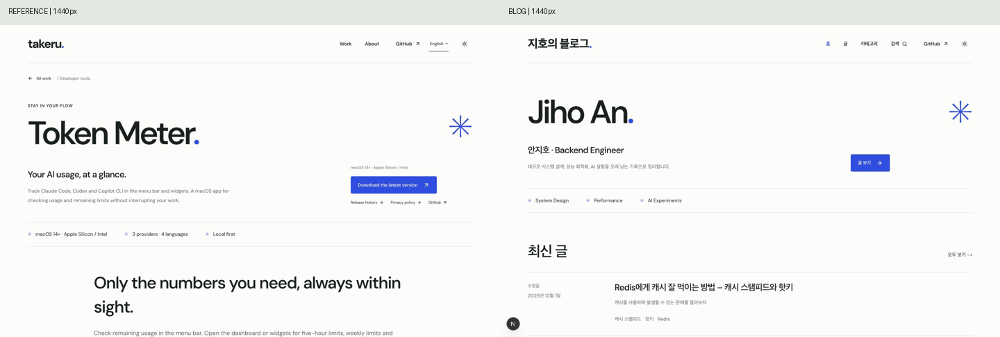
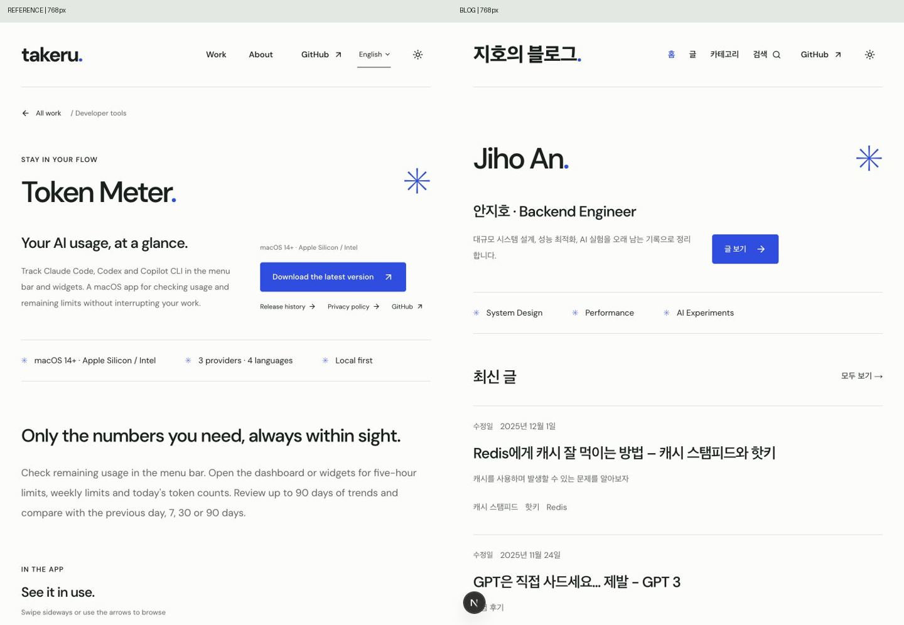
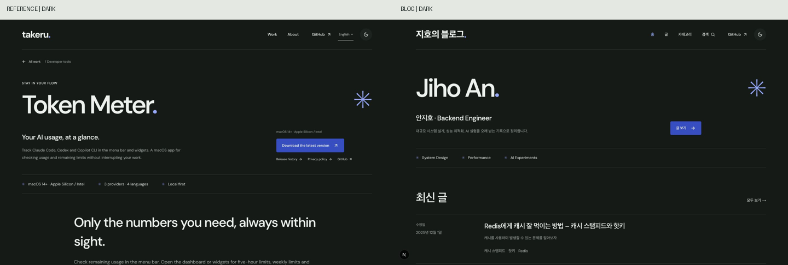
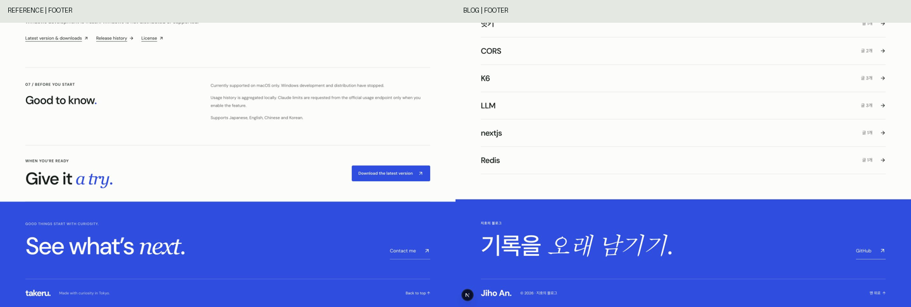

# 원본과 현재 블로그 디자인 재비교

검토일: 2026-10-15  
원본: [Token Meter — Takeru](https://takeruf.com/en/projects/token-meter)  
블로그: http://127.0.0.1:3000/

## 평가

**원본 디자인의 핵심 특징은 잘 유지됐다.** 색상, Latin 제목의 서체·굵기·크기·자간, 외곽 폭과 헤더 높이, 파란 버튼의 규격, 별표와 마침표, 가는 구분선, 파란 푸터가 같은 계열이다. 최근 사용성 수정 후에도 다른 시각 스타일로 바뀌지 않았다.

전체 인상에는 차이가 있다. 원본은 제품 이미지와 설명이 번갈아 나오는 제품 소개 페이지이고, 블로그는 이름·글 제목·카테고리가 반복되는 기록 목록이다. 따라서 블로그가 더 빠르게 읽히고 정보 밀도가 높다. 콘텐츠 구조를 고려하면 자연스러운 차이이며, 원본의 제품 이미지나 긴 소개 영역을 그대로 추가할 근거는 없다.

이번 작업은 **새 캡처·측정·비교 보고서만** 추가했다. 코드는 수정하지 않았다.

## 비교 조건과 캡처

이전 캡처를 재사용하지 않고 라이브 원본과 현재 블로그를 같은 브라우저에서 다시 열었다. 각 짝은 동일한 화면 크기와 밝은 테마, 페이지 맨 위에서 캡처했다. 비교 이미지에서는 양쪽에 동일한 축소 비율을 적용했다.

| 화면 | 원본 / 블로그의 실제 크기 | 비교 이미지 |
| --- | --- | --- |
| 데스크톱 | 1440 × 900 | [비교](comparison-1440.png) |
| 태블릿 | 768 × 1024 | [비교](comparison-768.png) |
| 모바일 | 390 × 844 | [비교](comparison-390.png) |
| 푸터 | 1440 × 900, 각 페이지 하단 | [비교](comparison-footer.png) |
| 다크 테마 | 1440 × 900 | [비교](comparison-dark.png) |

추가로 블로그 상세를 같은 세 크기에서 캡처해, 홈의 스타일이 읽기 화면에도 이어지는지 확인했다. 각 화면의 원본 크기 JPG와 [측정값](metrics.json), [푸터 측정값](footer-metrics.json)을 이 폴더에 보관했다.

## 1. 색상과 타이포그래피

| 항목 | 원본 | 블로그 | 판단 |
| --- | --- | --- | --- |
| 밝은 배경 | `#fcfdfb` | `#fcfdfb` | 동일 |
| 기본 잉크 | `#17201e` | `#17201e` | 동일 |
| 주 버튼·푸터 배경 | `#254ee8` | `#254ee8` | 동일 |
| 어두운 배경 / 잉크 | `#141a17` / `#edf1ed` | `#141a17` / `#edf1ed` | 테마 전환 후 동일 |
| Latin 대표 제목 | DM Sans / 550 | DM Sans / 550 | 동일 |
| 대표 제목 크기 | 93.6 / 49.92 / 35.1px | 93.6 / 49.92 / 35.1px | 세 크기에서 동일 |
| 대표 제목 자간 | −0.065em | −0.065em | 동일 |
| 버튼 글자 | 13px / 550 | 13px / 550 | 동일 |

**차이가 나는 부분:** 원본은 일본어 대체 폰트 체계이고, 블로그는 한국어 시스템 대체 폰트를 사용한다. 따라서 한글 로고·제목의 획과 무게감은 Latin 위주 원본과 다르게 보인다. Latin DM Sans 체계가 사라진 것은 아니다.

블로그 본문은 짙은 잉크색 17px, 모바일15px이고, 원본의 설명 문단은 주로 회색16px, 모바일15px다. 장문을 읽는 블로그가 더 선명하게 보이는 차이다. 최근 커진 날짜·태그14px와 불투명 흰색 푸터 저작권도 사용성 보완에 해당한다. 새로운 팔레트를 도입한 변화는 없다.

## 2. 여백과 레이아웃

| 항목 | 원본 | 블로그 | 판단 |
| --- | --- | --- | --- |
| 헤더·외곽 폭 | 1280 / 696 / 350px | 1280 / 696 / 350px | 동일 |
| 헤더 높이 | 110 / 110 / 82px | 110 / 110 / 82px | 동일 |
| 데스크톱 CTA 왼쪽 위치 | x=1010px | x=1010px | 분할 배치 기준 유지 |
| 태블릿 CTA 왼쪽 위치 | x=442px | x=442px | 분할 배치 기준 유지 |
| 모바일 CTA 왼쪽 위치 | x=20px | x=20px | 세로 배치 기준 유지 |
| 데스크톱 대표 제목 위쪽 | y=261px | y=200px | 블로그가61px 일찍 시작 |

블로그 홈에는 원본의 뒤로 가기, 제품 분류, 작은 소개 라벨, 다운로드 부가 링크가 없다. 설명도 짧아 첫 영역이 더 낮다. 원본의 여백 체계를 버렸기 때문이 아니라 해당 콘텐츠가 생략된 결과다. 두 사이트 모두 왼쪽 정렬과 제한된 정렬선을 반복한다.

원본 중간은 이미지와 설명의 분할 섹션, 블로그 중간은 날짜와 글 내용의 분할 행이다. 구조는 다르지만 **얇은 선으로 영역을 나누고, 제목 크기로 위계를 만드는 방식**이 유지된다.

세 크기에서 비교한 홈과 블로그 상세에는 페이지 가로 넘침이 없었다.

## 3. 버튼 및 카드 디자인

주 버튼은 양쪽 모두 **높이50px, 모서리4px, 흰 글자, 파란 단색 배경**이다. 기본 배경 전환 설정도 양쪽 `background 0.18s`로 측정됐다. 블로그 버튼 폭은 약113px, 원본은 약248px로 다르지만 문구 길이에 따른 자연스러운 차이다. 데스크톱·태블릿·모바일 모두 같은 규격을 유지한다.

원본의 미디어 영역과 블로그의 글 행을 카드 개수나 사진 비율로 직접 비교하지 않았다. 블로그는 배경색·그림자가 강조되는 독립 카드 대신 평평한 글 행을 쓴다. 원본의 구분선·인덱스 형태와 잘 이어진다. 큰 둥근 카드, 그라데이션, 상시 부유 그림자 같은 새로운 스타일이 추가되지 않았다.

목차·검색·페이지 번호·코드 복사·이미지 확대는 블로그에 필요한 확장이다. 기존 색과 작은 모서리, 텍스트·아이콘 중심의 조작부를 사용한다. 이미지 확대는 열었을 때만 별도 화면이 나타나며 평소 본문을 새 카드로 감싸지 않는다.

## 4. 애니메이션과 인터랙션

**직접 확인한 사항:** 라이브 원본과 블로그에서 테마 버튼을 눌러 밝은 테마 → 어두운 테마 → 밝은 테마로 바뀌는 것을 확인했다. 결과 배경·잉크색은 일치한다. 비교 후 두 사이트의 밝은 테마를 복원했다.

블로그 구현은 기존 원본 복제 기준과 같은 **클릭 위치 중심의 원형 확산, 600ms, cubic-bezier(0.2, 0.7, 0, 1)** 설정을 유지한다. 현재 라이브 원본의 애니메이션 내부 설정을 새로 추출하거나 프레임별 시간 차이를 측정한 검토는 아니다. 따라서 전환 시간·진행률이 프레임 단위로 완전히 같다고 단정하지 않는다.

두 사이트 모두 읽는 도중 계속 움직이는 장식보다 컨트롤 조작에 반응하는 절제된 방식이다. 원본의 이미지 갤러리와 블로그의 페이지 이동·목차는 기능이 다르므로 동일한 동작을 요구할 수 없다. 블로그에 별도의 섹션 등장 모션이나 상시 루프 영상을 추가하지 않은 점은 원본의 차분한 인상을 유지하는 데 맞는다.

최근 수정한 모바일 메뉴 자동 닫힘과 이미지 원본 보기·키보드 포커스 복귀는 기능 보완이다. 시각적 정체성을 바꾸는 변화로 판단하지 않았다. 세부 기능 검증은 [직전 수정 기록](../taste-fixes/REPORT.md)을 함께 참고한다.

## 5. 전체적인 디자인 분위기

| 공통 인상 | 현재 블로그에서 확인한 근거 |
| --- | --- |
| 차분하고 절제됨 | 옅은 바탕, 짙은 글자, 제한된 파란 강조색 |
| 편집물 같은 위계 | 큰 이름·페이지 제목, 왼쪽 정렬, 일정한 간격과 구분선 |
| 가벼운 개성 | 파란 마침표·별표, 푸터의 제한적인 이탤릭 |
| 평평하고 선명한 UI | 작은 버튼 모서리, 텍스트 행, 과한 그림자 없음 |

**원본보다 달라진 인상:** 블로그는 제품 이미지와 영어 설명이 줄고 한글 글 제목이 반복되어, 제품 쇼케이스보다 기술 기록 아카이브의 성격이 강하다. 이는 콘텐츠와 화면 목적의 차이로 설명된다. 동일한 디자인 언어를 다른 정보 구조에 적용한 결과로 보인다.

## 실제 스타일 차이와 그 의미

1. **한국어 푸터의 이탤릭 질감:** 양쪽 CSS는 Georgia/serif/italic이지만 Georgia가 한글을 직접 담지 않으므로 한국어 부분은 환경의 대체 글꼴로 표시된다. 원본의 Latin 세리프와 시각적으로 완전히 같지 않다. 새로운 폰트를 적용하자는 뜻은 아니며, 남아 있는 질감 차이를 기록한 것이다.
2. **푸터 제목 자간:** 원본 −0.05em(76px에서−3.8px), 블로그 −0.035em(−2.66px). 크기76px와 상단 여백62px, 배경은 같다. 작은 차이이며 전체 정체성을 깨뜨리지는 않는다.
3. **첫 영역의 밀도:** 블로그의 제목과 CTA가 더 위에 있고 최신 글이 빨리 보인다. 원본에만 필요한 라벨·플랫폼·배포 링크를 억지로 넣을 이유는 없다.
4. **읽기 정보의 강조:** 블로그의 본문·날짜·태그와 저작권이 더 선명하다. 원본의 작은 부가 설명보다 정보 탐색과 장문 읽기를 우선한 조정이다.
5. **실제 글 이미지의 색:** Redis 그림·그래프의 빨강과 초록은 콘텐츠 자산의 색이다. UI 팔레트 변경으로 보지 않는다.

## 최종 판단

- **색상·대표 타이포그래피·외곽 레이아웃·버튼:** 원본 특징이 강하게 유지됨.
- **목록·본문·보조 정보:** 블로그에 맞게 확장됐으며 공통 스타일이 일관됨.
- **모션·조작 방식:** 절제된 방향을 유지함. 라이브 원본과 프레임 단위 동일성은 미측정.
- **남은 차이:** 한글 대체 서체의 질감, 푸터 자간, 첫 화면의 밀도. 구조와 언어 차이를 고려하면 전면 수정이 필요한 스타일 이탈로 판단하지 않음.

현재 상태는 원본의 특징을 유지한 개인 블로그로 평가한다. 이번 비교에서는 코드 수정안을 실행하지 않았다. 캡처 왼쪽 아래 `N`은 로컬 개발 표시기이며 원본과의 디자인 차이에서 제외했다.
