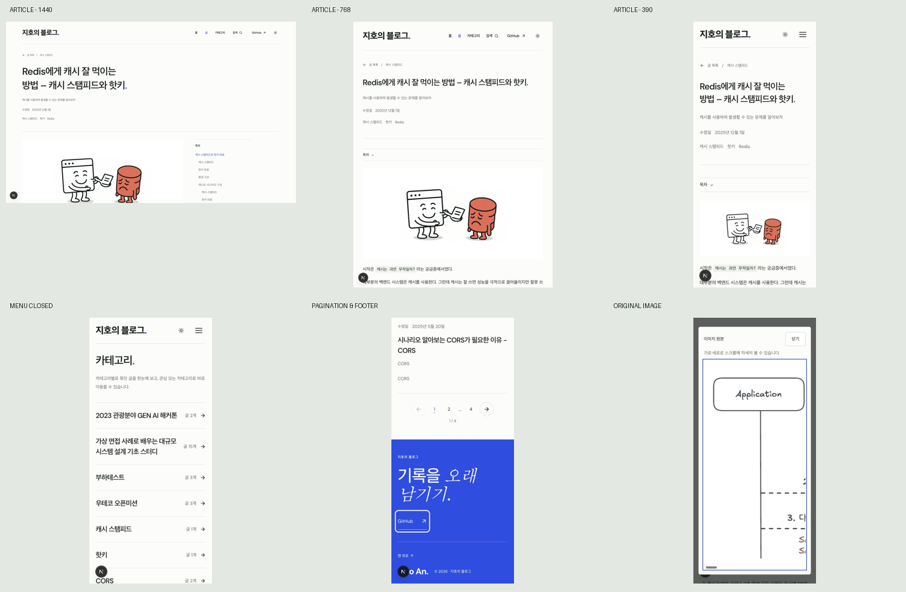

# Taste 검토 후 UI 수정·검증 결과

2026-10-15 · `feature/token-meter-replica`  
기준: [이전 검토 보고서](../taste-review/REPORT.md)

기존 스타일을 유지하면서 A1·A2와 B1–B6을 수정했다. 사진·영상 수량, 섹션 구성 다양화, 구분선 제거 등 취향에 따른 권장은 적용하지 않았다.

## 수정 사항

| 검토 항목 | 수정 | 실제 검증 |
| --- | --- | --- |
| A1 푸터 대비 | 저작권 문구만 기존 불투명 흰색 사용 | 브라우저 색 `rgb(255,255,255)`. 기존 파란 배경에서 밝은 테마 약 6.30:1, 어두운 테마 약 6.84:1. 배경·테두리 토큰은 그대로다. |
| A2 이미지 설명 | Markdown과 직접 작성된 JSX 이미지를 같은 컴포넌트로 처리 | Redis 글의 정보 이미지 14개에 실제 내용에 맞는 설명, 장식 썸네일 1개에 명시적인 빈 설명. 누락된 alt 0개. |
| B1 모바일 메뉴 | 내부 링크·같은 페이지 검색·경로 변경 시 닫힘, Escape 지원 | 상세 → 카테고리 이동 후 `open=false`. 키보드 검색 선택 후 입력창 포커스. Escape 후 메뉴 버튼 포커스. |
| B2 작은 정보 | 날짜·태그·글 수·결과 수를 기존 14px 단계, 보조 라벨13px로 조정 | 홈·목록·검색·카테고리에서 공유 스타일 적용 확인. |
| B3 작은 도표 | 본문 크기는 유지하고 이미지 원본 대화상자 제공 | Enter·클릭 열기, 원본 2560px 도식을 324px 내부 영역에서 스크롤. ArrowRight로 40px 이동 확인. Escape·닫기 후 링크로 포커스 복귀, 배경 스크롤 잠금 해제. |
| B4 줄바꿈 | 제목 균형 줄바꿈, 한글 구절의 단어 단위 줄바꿈 | 1440px의 `핫키.` 단독 줄과 모바일 `남/기기` 분리 해소. 서체·제목 크기 유지. |
| B5 섹션 경계 | 카테고리 뒤 글 목록에 기존 제목 규격의 `전체 글.` 추가 | 전체 카테고리와 기존 글 목록 모두 유지하며 화면 경계를 명확히 표시. |
| B6 페이지 번호 | 모바일 숫자 버튼 44×44px, 숫자 사이 간격 확보 | 2페이지에서 숫자·이전·다음 버튼 모두44px. 페이지 가로 넘침 없음. |

## 보존한 디자인과 기능

기본 배경 `#fcfdfb`, 잉크 `#17201e`, 파란색 `#254ee8`, DM Sans와 한국어 시스템 대체 폰트, 1280px 외곽 폭, 800px 본문 폭, 280px 목차, 별표·마침표·구분선·작은 모서리·파란 푸터·600ms 테마 모션을 유지했다.

`app/design-tokens.css`, 원본 복제 페이지 HTML·CSS의 수정 전후 해시가 동일하다. [이전 해시](reference-hashes-before.txt), [이후 해시](reference-hashes-after.txt).

`posts`, `lib`, `data` 변경 없음 확인. 검색 범위·정렬·페이지 이동·경로·카테고리 구조와 원문은 유지했다. 설명 메타데이터와 확대 기능은 공통 이미지 계층에 추가했다.

이미지 설명은 Redis 글 15개를 구체적으로 검증했다. 다른 글은 기존 작성자가 제공한 설명을 유지하며, 설명 없는 이미지에 일반적인 참고 이미지 설명을 사용한다. 모든 글 이미지의 의미 설명을 개별 검수한 것은 아니다.

## 브라우저 검증

홈·글 목록·카테고리·Redis 검색·Redis 상세를 **1440×900 / 768×1024 / 390×844**, 총15개 화면에서 캡처하고 확인했다.

- 모든 화면: 페이지 가로 넘침 없음, 깨진 이미지 없음.
- 대표 제목: 데스크톱93.6px/550, 태블릿49.92px, 모바일35.1px 유지.
- 본문: 17px → 모바일15px 유지. 데스크톱800px, 태블릿696px, 모바일350px.
- 전체 글: 기존27개, 페이지당8개. Redis 검색1개, 초기화 정상.
- 오래된 순 정렬과2페이지 이동 후8개 글 표시 정상.
- 목차 앵커 이동 후 모바일 목차 닫힘, 코드 블록3개와 복사 완료 안내 확인.
- 이미지 대화상자 내부 스크롤·키보드·포커스 복귀 확인.

전체 측정값: [browser-measurements.json](browser-measurements.json).

대표 캡처: [데스크톱 상세](article-1440.jpg), [태블릿 상세](article-768.jpg), [모바일 상세](article-390.jpg), [이동 후 닫힌 메뉴](mobile-menu-after-navigation.jpg), [번호와 푸터](mobile-pagination-footer.jpg), [확대 보기](mobile-image-expanded.jpg), [코드 복사](code-copy.jpg). 각 화면의 나머지 크기 캡처도 이 폴더에 보관했다.

## 코드 검사

- 최종 `npm run build` 통과. 기존 경로를 포함한82개 정적 경로 생성. [빌드 기록](build.log).
- `eslint app components lib --ext js,mjs` 통과. [검사 기록](eslint.log).
- `git diff --check` 통과.
- 최종 정적 산출물에도 포커스 가능한 이미지 링크와 확대 화면 스타일이 포함된 것을 확인했다.

작업은 로컬 변경 상태다. 커밋·배포하지 않았다. 캡처 왼쪽 아래 개발 표시기는 배포 UI에 포함되지 않는다.
