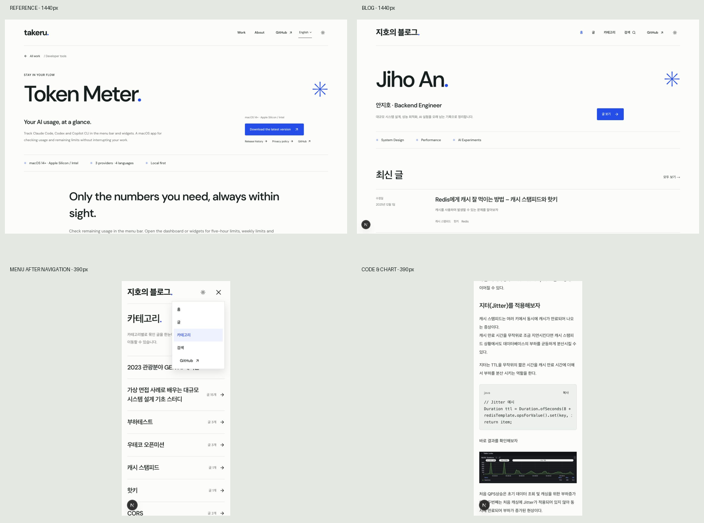

# Taste Skill 블로그 디자인 평가

검토일: 2026-10-15  
기준: [승인된 디자인 시스템](../DESIGN-SYSTEM.md), [블로그 화면 설계](../BLOG-SCREENS.md), [Token Meter 원본](https://takeruf.com/en/projects/token-meter)  
대상: 로컬 블로그 `http://127.0.0.1:3000/`

## 판단 요약

레퍼런스의 정체성은 잘 유지됐다. 밝은 종이색 바탕, 짙은 글자, 파란 마침표와 별표, DM Sans, 왼쪽 정렬, 가는 구분선, 작은 모서리의 버튼, 파란 푸터가 일관된다. 게시글은 평평한 행으로 확장되어 홈·목록·검색에서 같은 시각 언어를 사용한다.

**필수 수정 사항은 2건**이다. 푸터 저작권 문구의 대비 부족과 정보 이미지의 대체 설명 누락이다. 별도로 모바일 메뉴의 이동 후 유지, 작은 보조 글자, 모바일 도표, 제목 줄바꿈, 카테고리 화면의 섹션 경계, 작은 페이지 번호 영역은 사용성 개선 대상으로 분류했다.

프로젝트 코드·디자인 토큰·콘텐츠는 수정하지 않았다. `draw.mjs`를 실행하지 않았고, 새로운 디자인 방향도 만들지 않았다. 이번 작업에서 추가한 파일은 평가 문서, 검사 로그·측정값과 캡처뿐이다.

## 검사 방법과 범위

- `lint.mjs app components --json`: 실제 UI 소스 30개 검사.
- `inspect.mjs`: 홈, 글 목록, 카테고리, Redis 검색, Redis 상세, 원본을 **1440×900 / 768×1024 / 390×844**에서 각각 검사·캡처. 예외 목록 `--allow`로 결과를 숨기지 않았다.
- `references/critique.md`: 14개 시각 검토 항목과 가중 평가 적용. 사진·영상·모션 수량과 구분선 금지처럼 사용자 목표와 충돌하는 규칙은 C 또는 D로 분리했다.
- 실제 인앱 브라우저: 모바일 메뉴 이동, 목차 펼침·앵커 이동·닫힘, 코드 복사 안내, 테마 전환, 코드 스크롤 영역, 긴 글 하단 탐색, 실제 본문 크기를 추가 확인했다.
- 대비: 브라우저의 실제 색상과 토큰으로 상대 휘도를 계산했다. 반투명 푸터 문구는 배경과 합성해서 계산했다.

자동 도구는 페이지당 최대 12개 화면을 캡처한다. 긴 Redis 글의 마지막 부분은 인앱 브라우저에서 별도로 확인했다. 모든 27개 글의 본문을 개별 검사한 결과는 아니며, Markdown·코드·이미지가 많은 Redis 글을 대표 표본으로 사용했다. 실제 기기 대신 지정한 브라우저 뷰포트를 사용했다.

## 현재 디자인 구조

| 계층 | 구조와 관찰 |
| --- | --- |
| 기준 문서 | 루트 `DESIGN.md`가 승인 문서 두 개를 연결한다. 이전 민트색 카드 스타일 대신 Token Meter 기준을 명시한다. |
| 토큰 | `app/design-tokens.css`: 의미 기반 밝은/어두운 색, 폰트, 너비, 여백, 글자 크기, 모서리, 모션 시간. |
| 공통 스타일 | `app/globals.css`: 헤더·푸터·글 행·검색·목차·Markdown과 반응형 규칙. |
| 페이지 틀 | `Container`, `SiteHeader`, `SiteFooter`, `PageIntro`. |
| 목록 | `PostCard`, `TagLinks`, `PostIndexShell`, `SearchField`, `Pagination`. 홈과 검색에서 같은 행을 재사용한다. |
| 읽기 | `MDXContent`, `CodeBlock`, `ArticleTOC`, `PostNavigation`. |
| 인터랙션 | `ThemeSwitcher`의 600ms 원형 전환, 네이티브 메뉴·필터·목차, 호버·포커스. 동작 줄이기 설정 대응은 소스에서 확인했다. |

본문 최대 폭 800px, 데스크톱 목차 280px, 두 영역 사이 60px이다. 1100px 이하에서는 목차가 본문 위 접이식으로 바뀐다. 글 행은 800px 이하에서 날짜와 본문을 세로로 쌓는다. 헤더는 760px 이하에서 모바일 메뉴가 된다.

표는 스크롤 영역과 키보드 포커스를 제공한다. 코드도 넘치는 경우 키보드 포커스를 제공한다. 이 검토에서 실제 표가 포함된 별도 글의 화면까지 검사하지는 않았다.

## 자동 도구 결과와 해석

| 검사 | 원시 FAIL | 원시 WARN | 주요 결과 |
| --- | ---: | ---: | --- |
| 소스 lint | 20 | 8 | 구분선 15, 그림자 2, 별표 2, 코드 폰트 토큰 1이 FAIL. |
| 홈 | 6 | 3 | 별표·구분선·이미지 수·작은 글자·모션 수·빈 화면 면적. |
| 글 목록 | 6 | 4 | 구분선·팝업 그림자·이미지 수·작은 글자·모션 수·빈 화면 면적. |
| 카테고리 | 6 | 4 | 목록과 동일한 종류. |
| 검색 | 5 | 4 | 목록과 동일하나 빈 화면 면적 FAIL은 없음. |
| 상세 | 4 | 5 | 구분선·코드 테두리·대표 요소 크기·모션 수; 읽기 폭 경고. |
| 원본 | 7 | 7 | 원본도 별표·구분선·라벨·번호·작은 글자·모션 규칙에서 FAIL. |

모든 inspect 실행은 원시 FAIL 때문에 종료 코드 1을 반환했다. **이 숫자는 실제 오류의 개수가 아니다.** 원본도 같은 규칙에 걸리므로 이를 모두 제거하면 사용자가 요청한 디자인 보존을 위반한다.

오탐 또는 범위 한계도 확인했다.

- `mono`: 코드용 토큰 선언을 검사한 결과다. 실제 렌더에서는 본문이 DM Sans 계열이며 고정폭 글자는 코드에 사용된다.
- `shadow`: 카테고리 필터 팝업을 정지 카드로 분류했다. 실제 용도는 겹쳐 뜨는 메뉴다.
- 태블릿의 대표 제목을 별표 62px로 잘못 선택했다. 실제 홈 `h1`은 **49.92px / 550**이다.
- 상세 일부 `h3`를 42px로 집계했지만 실제 스타일은 **25px**다. DOM에서 확인한 값은 [manual-measurements.json](manual-measurements.json)에 기록했다.
- 대비 경고가 없었지만, 반투명 푸터 문구의 합성 대비를 놓쳤다. 따라서 자동 검사 통과를 전체 대비 통과로 해석하지 않았다.

로그와 측정값은 각 화면 폴더의 `report.json` 및 상위 `*-inspect.log`, [lint.json](lint.json)에 보존했다.

## A. 실제 오류 — 반드시 수정

### A1. 푸터 저작권 문구의 대비 부족 · P1

**페이지:** 모든 화면 공통 푸터. 대표 증거는 검색 페이지, 768px.

**문제:** 12px 저작권 문구가 반투명 흰색 `#ffffffb8`이다. 밝은 파란 배경에서는 약 **4.04:1**, 어두운 파란 배경에서는 약 **4.39:1**이다. 일반 크기 텍스트의 4.5:1 기준에 못 미친다. [W3C 대비 기준](https://www.w3.org/WAI/WCAG22/Understanding/contrast-minimum.html)

**근거:** [밝은 푸터 캡처](footer-light.jpg), [어두운 푸터 캡처](footer-dark.jpg), [실제 브라우저 스타일](footer-styles.json), [합성 대비 계산](contrast.json). 위치는 각 캡처 하단 `© 2026 · 지호의 블로그`다. 스크린샷만으로 대비를 판정하지 않고 실제 전경색과 배경색을 함께 확인했다.

**개선:** 파란 배경은 유지하고 저작권 텍스트에 기존의 불투명 흰색 토큰을 사용하거나 불투명도만 충분히 높인다. 변경 후 두 테마에서 다시 계산한다. 새로운 색상은 필요하지 않다.

### A2. 정보 이미지의 대체 설명 누락 · P1

**페이지:** `/blog/backend/cache-stampede/`, 세 크기 공통.

**문제:** DOM에서 본문 이미지 15개 모두 `alt` 속성이 없는 것을 확인했다. 도식과 성능 그래프는 정보를 전달하므로 스크린리더 이용자가 무엇을 보여주는지 알 수 있어야 한다. 주변 설명 문단만으로 각 이미지의 역할을 연결하기 어렵다.

**근거:** [모바일 본문 시트](article/mobile-page-01.jpg)의 시퀀스 도식·QPS 그래프, [그래프 캡처](mobile-code-and-chart.jpg). 실제 요소의 `getAttribute('alt')`가 `null`이었다. 원본 MDX의 `posts/Backend/cache_stampede.mdx:23`도 대체 설명 없는 ``다. 기존 콘텐츠에서 이어진 문제이며 이번 스타일 적용이 새로 만든 문제로 판단하지 않았다.

**개선:** 정보를 담는 도식·그래프에 내용에 맞는 짧은 설명을 제공한다. 장식용 썸네일은 의도적으로 빈 설명을 지정할 수 있다. 추후 수정할 때 기존 MDX 원문과 직접 작성된 ``가 실제로 렌더되는 경로를 확인해야 한다. 공통 이미지 컴포넌트의 기본값만으로 모든 원문 이미지가 처리된다고 가정하지 않는다.

## B. 사용성·가독성 개선

### B1. 페이지 이동 후 모바일 메뉴가 계속 열려 있음 · P1

**페이지:** 모바일 상세 → 카테고리 이동, 390px.

**문제:** 메뉴에서 카테고리를 선택해 이동한 뒤에도 메뉴가 열려 있다. 새 화면의 설명과 첫 카테고리 행을 가린다. 이용자가 닫기 버튼을 한 번 더 눌러야 한다.

**근거:** [이동 직후 캡처](mobile-menu-after-navigation.jpg). DOM의 `details.open=true`, 팝업 영역은 y=72.5–316.5px이다. 카테고리 제목 자체가 완전히 가려지는 것은 아니지만 설명과 첫 행 오른쪽이 덮인다.

**개선:** 내부 링크 선택 또는 경로 변경 후 닫는다. 키보드 사용 시 목적지로 포커스가 자연스럽게 이어지는지도 확인한다. 메뉴의 색·폭·모서리는 유지한다.

### B2. 날짜·태그·결과 수가 12px여서 탐색 정보가 약함 · P2

**페이지:** 홈, 목록, 검색, 카테고리. 특히 390px.

**문제:** 색 대비는 충분하지만 날짜·태그·글 수가 12px이다. 게시글 선택에 사용하는 정보인데 제목과 비교해 작고 얇게 보인다. 원본의 부가 라벨을 그대로 확장하면서 블로그 탐색 정보까지 같은 작은 단계로 묶었다.

**근거:** [모바일 목록](posts/mobile-fold.jpg), [모바일 카테고리](category/mobile-fold.jpg), [태블릿 목록](posts/tablet-fold.jpg). 라벨은 12px, 글 제목은 22–25px이다.

**개선:** 탐색에 직접 쓰이는 날짜·태그·결과 수만 기존 14px 단계 또는 13px 단계로 올리는 방안을 검토한다. 전체 보조 글자를 일괄 확대하지 않고, 색·서체·정렬은 유지한다. 12px 자체를 기능 오류나 대비 실패로 분류하지 않았다.

### B3. 모바일 성능 그래프와 도식의 내부 글자를 읽기 어려움 · P1

**페이지:** Redis 상세, 390px.

**문제:** 큰 도식과 그래프가 350px 폭으로 축소된다. 페이지 넘침은 없지만 축·범례·로그 숫자가 매우 작아진다. 현재 이미지 자체를 눌러 확대하거나 원본을 열 수 있는 별도 동작이 없다.

**근거:** [그래프 캡처](mobile-code-and-chart.jpg), [모바일 상세 첫 시트](article/mobile-page-01.jpg), [두 번째 시트](article/mobile-page-02.jpg). 코드 아래 QPS 그래프와 시퀀스 도식에서 확인된다.

**개선:** 본문에서의 기존 이미지 크기는 유지하고 원본 이미지 열기 링크 또는 키보드로도 작동하는 확대 기능을 제공한다. 핵심 수치는 본문의 기존 설명과 연결한다. 모바일에서 이미지를 무조건 크게 늘려 페이지 전체 가로 넘침을 만드는 해결책은 피한다.

### B4. 제목과 푸터의 줄바꿈이 단어를 어색하게 분리함 · P2

**페이지:** Redis 상세 1440px, 공통 푸터 390px.

**문제:** 상세 제목 마지막 줄에 `핫키.`만 남는다. 모바일 푸터는 `오래 남` / `기기.`로 끊어진다. 제목 크기나 이탤릭 사용 자체가 아니라 줄의 균형과 의미 단위가 문제다.

**근거:** [데스크톱 상세](article/desktop-fold.jpg), [모바일 페이지 이동·푸터](mobile-pagination.jpg).

**개선:** 문구·폰트·크기는 유지하고 제목의 균형 줄바꿈, 푸터 강조 구절의 단어 단위 줄바꿈을 검토한다. `keep-all` 또는 제한적인 구절 묶음을 적용할 때 390px에서 가로 넘침이 생기지 않는지 확인한다. 전체 본문에 무조건 줄바꿈 금지를 적용하지 않는다.

### B5. 카테고리 목록 뒤 전체 글 목록으로 바뀌는 지점의 표제가 없음 · P2

**페이지:** `/category/`, 세 크기 공통.

**문제:** 11개 카테고리 뒤에 검색·정렬과 전체 글 27개가 이어진다. 시각적 `전체 글` 제목 없이 같은 가는 구분선만 반복되어 현재 어떤 목록을 읽는지 알아차리기 어렵다. 기능과 콘텐츠가 사라진 문제는 아니다.

**근거:** [카테고리 전체 시트](category/desktop-page-01.jpg), 상단 오른쪽 패널의 Redis 행 바로 아래 검색 도구와 글 목록.

**개선:** 전체 글 목록 위에 기존 섹션 제목 규격으로 `전체 글`을 추가한다. 검색·정렬·데이터와 기존 카테고리 구조는 유지한다. 카테고리를 카드 그리드로 바꿀 필요는 없다.

### B6. 모바일 페이지 번호의 누를 수 있는 폭이 32px · P2

**페이지:** 글 목록·카테고리의 페이지 이동, 390px.

**문제:** 화살표 버튼은 44×44px이나 숫자 버튼은 32×44px이고 옆 숫자와 붙어 있다. 좁은 화면에서 다른 번호를 누르기 쉽다. 이번 보고서에서 이것을 접근성 기준의 자동 실패라고 주장하지 않는다.

**근거:** [모바일 페이지 번호](mobile-pagination.jpg), 실제 영역 측정: 이전·다음 44px, 1·2·4 번호 32px.

**개선:** 기존 번호·화살표 표현을 유지하고 숫자의 폭과 간격을 확보한다. 필요하면 모바일에서 보이는 번호 수를 줄여 공간을 만든다.

## C. Taste Skill의 취향에 따른 권장 — 선택 사항

| 항목 / 우선순위 | 페이지와 스크린샷 근거 | 규칙이 권하는 변경 | 이번 판단 |
| --- | --- | --- | --- |
| C1. 사진 4개 이상·영상 요구 / P3 | 홈·목록·검색: [홈 시트](home/desktop-page-01.jpg), [검색](search/desktop-fold.jpg) | 실제 사진과 영상 추가 | 텍스트 중심 기술 블로그에 필수적이지 않다. 수량을 채우는 사진·영상을 추가하지 않는다. 실제 글의 이미지가 필요한 자리에서만 사용한다. |
| C2. 섹션마다 다른 구성 요구 / P3 | 홈 최신 글·카테고리: [홈 시트](home/desktop-page-01.jpg) | 반복 목록 대신 서로 다른 구성 | 목록의 반복은 탐색을 예측 가능하게 한다. 스타일 변경보다 B5의 명확한 제목이 우선이다. |
| C3. 글자 크기 약 5단계 요구 / P3 | [홈](home/desktop-page-01.jpg), [상세](article/desktop-fold.jpg) | 10–13개 실측 크기 축소 | 본문·메타·제목·코드·푸터·아이콘의 역할이 다르다. 별표 크기를 글자 크기로 집계한 부분도 있다. 중복 토큰은 추후 정리할 수 있지만 시각 체계를 강제로 5단계로 줄이지 않는다. |

## D. 원본 디자인 유지가 더 중요한 사항

| 항목 / 우선순위 | 페이지와 스크린샷 근거 | Taste 지적 | 유지 방법 |
| --- | --- | --- | --- |
| D1. 가는 구분선·평평한 행 / 유지 | [원본](reference/desktop-fold.jpg), [목록](posts/desktop-fold.jpg), [카테고리](category/desktop-fold.jpg) | `hairline`, `outlined-box` | 원본의 구조적 특징이다. 행과 섹션 구분선을 유지하며 부유 카드·큰 모서리로 바꾸지 않는다. 코드와 입력 테두리는 기능적 구획이다. |
| D2. 파란 별표·마침표 / 유지 | [원본](reference/desktop-fold.jpg), [홈](home/desktop-fold.jpg) | `emoji` | 동일한 별표 모티프이며 컬러 이모지를 임의 추가한 사례가 아니다. 화면에서 보이는 모양을 유지한다. 렌더 차이가 생기면 같은 모양의 벡터로 구현하는 정도만 고려한다. |
| D3. 절제된 모션 / 유지 | [원본](reference/desktop-fold.jpg), [모바일 홈](home/mobile-fold.jpg), [다크 화면](mobile-dark.jpg) | `still-page`, `no-footage` | 로드·스크롤 애니메이션 수를 8개 이상으로 채우지 않는다. 기존 테마 전환과 컨트롤 피드백을 유지하고 읽기를 방해하지 않는다. inspect의 수량 측정은 사용자가 누르는 테마 전환을 검증하지 않는다. |
| D4. 파란 푸터·제한적 이탤릭 / 유지 | [홈 시트](home/desktop-page-01.jpg), [모바일 푸터](mobile-pagination.jpg) | `mixed-font-headline` | 원본 계열의 편집적 강조다. 이탤릭을 제거할 필요는 없다. A1 대비와 B4 줄바꿈만 국소적으로 수정한다. |
| D5. 코드용 고정폭 서체·가로 스크롤 / 유지 | [모바일 코드](mobile-code-and-chart.jpg) | lint `mono`, 일반적 가로 잘림 우려 | 실제 코드이므로 고정폭 서체가 맞다. 긴 줄을 보존하고 코드 내부에서 스크롤한다. 모바일 세 코드의 내부 폭은 316px, 실제 내용 폭은 354–704px이며 모두 포커스 가능하다. 페이지 전체는 넘치지 않는다. |
| D6. 메뉴 팝업의 그림자 / 유지 | [열린 메뉴](mobile-menu-open.jpg) | `shadow` | 실제 겹쳐 뜨는 메뉴의 경계 표현이다. 정지 카드에 그림자를 추가한 사례가 아니다. 그림자를 없애기보다 B1의 닫힘 동작을 다룬다. |

## 원본과 달라진 부분

| 항목 | 비교 결과 | 판단 |
| --- | --- | --- |
| 바탕·잉크·파란색 | 동일 계열 및 같은 핵심 값 `#fcfdfb`, `#17201e`, `#254ee8`. | 유지 성공. |
| Latin 제목 | 양쪽 1440px 대표 제목 93.6px / 550, 자간 −0.065em. 모바일 35.1px. | 유지 성공. 태블릿 실제 제목도 49.92px다. |
| 헤더 | 같은 외곽 폭과 구분선, 110px 높이, 모바일 82px. 블로그 로고는 한국어이므로 원본보다 길다. | 목적에 맞는 확장. 768px에서도 메뉴는 들어간다. |
| 첫 화면 높이 | 블로그 제목 y=200px, 원본 y=261px. 원본의 뒤로 가기·라벨·부가 다운로드 링크를 블로그 홈에서 생략했다. | 콘텐츠 구조 차이로 밀도가 높아졌다. 원본의 위치를 맞추기 위한 빈 라벨은 추가하지 않는다. |
| 본문 | 원본 설명은 주로 회색 16px. 블로그는 짙은 잉크 17px, 모바일 15px, 줄 높이 2. | 장문 읽기용 의도된 확장. 대비는 더 강하다. |
| 글 목록 | 원본의 제품 설명·이미지 섹션 대신 날짜/제목/설명/태그를 가진 행. | blog 목적에 맞는 공통화. 탐색 정보의 크기는 B2 대상. |
| 상세 제목 | 긴 글 제목은 28–48px이고 별도 900px 폭 제한이 있다. | 큰 display 제목을 그대로 강제하지 않는다. `focal-point` FAIL은 문서 읽기 화면에 부적합한 판정이다. |
| 읽기 폭 | 최대 800px + 280px 목차. 자동 도구는 약 94자/줄이라고 추정한다. | Latin 기반 추정치를 한글 실제 글자 수와 동일시하지 않는다. 승인된 800px를 임의 축소할 근거는 충분하지 않다. |
| 이미지 색 | 실제 글의 Redis 그림과 성능 그래프가 빨강·초록 등 원본 UI 팔레트 밖의 색을 포함한다. | 기존 콘텐츠의 색이다. 이미지까지 파란색으로 재색칠하지 않는다. |
| 푸터 강조 | 원본의 Latin 이탤릭과 달리 한국어는 OS 대체 폰트의 기울임으로 표시될 수 있다. | 임의의 새 한글 서체 도입 대신 현재 폰트 체계를 유지하고 줄바꿈을 다듬는다. |

## critique.md의 14개 검토 기록

| 관점 | 관찰 |
| --- | --- |
| 1. 첫 1초 | 홈은 `Jiho An.`, 카테고리는 큰 제목, 상세는 글 제목이 먼저 보인다. |
| 2. 큰 덩어리 | 제목 → 행 → 파란 푸터의 규모 차이가 명확하다. |
| 3. 로고 가리기 | 레이아웃 자체는 다른 기술 블로그에도 사용 가능하다. 독창성 부족을 이유로 승인된 레퍼런스를 교체하지 않는다. |
| 4. 정렬선 | 외곽 x=80px, 글 본문 x=330px, 상세 목차 x=940px 등 역할별 정렬을 반복한다. |
| 5. 여백 | 섹션 간 간격은 명확하나 카테고리 → 전체 글 경계의 표제가 약하다(B5). |
| 6. 글자 | 크기 계층은 명확하다. 메타 12px(B2), 단어 단위 줄바꿈(B4)이 약점이다. |
| 7. 색 | 밝은 바탕 대부분, 짙은 글자, 파란 강조·푸터. 푸터 저작권만 합성 대비가 부족하다(A1). |
| 8. 이미지 | 홈은 이미지 없음, 상세에는 실제 도식·그래프가 있다. 작은 화면 확대 경로가 필요하다(B3). |
| 9. 반복 | 글 행은 의도된 반복. 카테고리도 행 형태이므로 레퍼런스의 인덱스 언어와 일치한다. |
| 10. 모바일 | 날짜를 위로, 검색을 전체 폭으로, 목차를 접이식으로 바꾼다. 메뉴 이동 후 닫힘은 미흡하다(B1). |
| 11. 밀도 | 자동 면적 기준은 홈 3/4 화면을 비었다고 판정하지만 실제 목록 내용이 보인다. 텍스트만의 면적이 작다고 사진으로 채우지 않는다. |
| 12. 내용 | 실제 글·카테고리·날짜를 전달하며 홈 CTA가 첫 화면에 있다. 이미지 대체 설명은 빠졌다(A2). |
| 13. 충돌 | 기본 화면에는 페이지 넘침·깨진 이미지·콘텐츠 겹침이 없다. 열린 메뉴가 이동 후 새 콘텐츠를 덮는 경우는 B1이다. |
| 14. 실제 동작 | 검색·정렬·목차·코드 복사·테마 전환이 있다. 장식적 놀이터가 필요하지 않다. |

### ROUND 1 — 보고서 전용 검토

Seen in one second: 큰 이름과 파란 마침표, 가는 구분선으로 이어지는 글 목록.  
Idea: Token Meter의 편집적 인덱스 스타일로 개발자의 실제 기록을 정리한다.  
Live thing: 검색, 목차 앵커, 코드 복사, 테마 전환.  
Layout words by section: hero=split / latest=list / category=index / article=prose+toc / footer=blue field.  
Scores: design 7.5 · usability 7.0 · creativity 7.0 · content 8.0 → 문맥 반영 overall **7.3**.  
Caps applied: Taste 원시 기준을 그대로 적용하면 inspect FAIL 때문에 **6.0 상한**이다. 문맥 반영 점수는 사용자 제약에 따라 원본 구분선·별표·이미지 수·모션 수 등의 취향 규칙을 별도로 처리한 주관적 리뷰 점수다. 두 점수를 같은 기준의 합격 점수로 혼동하지 않는다.

Top three problems:

1. 푸터 저작권 대비(A1) — [footer-light.jpg](footer-light.jpg). 기존 흰색 토큰 또는 불투명도만 조정.
2. 정보 이미지 대체 설명 누락(A2) — [mobile-code-and-chart.jpg](mobile-code-and-chart.jpg) + 실제 DOM. 이미지 의미와 수치를 설명.
3. 이동 후 모바일 메뉴가 남음(B1) — [mobile-menu-after-navigation.jpg](mobile-menu-after-navigation.jpg). 경로 변경 시 닫기.

코드 수정이 금지된 단계이므로 수정·재검사 라운드는 진행하지 않았다.

## 후속 작업 순서

1. A1·A2: 팔레트를 유지한 대비 수정과 정보 이미지 설명.
2. B1·B3: 모바일 탐색과 이미지 읽기 개선.
3. B2·B4·B5·B6: 작은 정보 크기, 줄바꿈, 섹션 표제, 번호 영역 개선.
4. C는 선택 사항이며 수량 기반 사진·영상·모션 추가는 권하지 않는다. D는 유지한다.

검토 캡처의 왼쪽 아래 `N`은 개발 서버 표시기다. 배포 화면의 디자인 문제로 집계하지 않았다.
