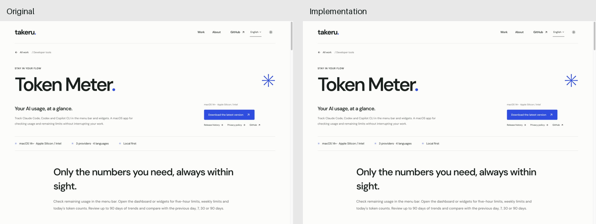

# Token Meter 원본 재현 및 비교 결과

작업 브랜치: `feature/token-meter-replica`  
원본: https://takeruf.com/en/projects/token-meter  
구현: `public/token-meter/index.html`  
실행: 저장소 루트에서 `npm run dev:replica`, http://127.0.0.1:4173/

## 브라우저에서 확인한 디자인

| 항목 | 원본 기준 |
| --- | --- |
| 페이지 너비 | 최대 1,280px, 기본 좌우 여백 56px |
| 반응형 여백 | 1,100px 이하 36px, 760px 이하 20px |
| 본문 폰트 | DM Sans 가변 폰트, Noto Sans JP 보조 폰트 |
| 헤더 | 데스크톱 110px, 모바일 82px |
| 제목 | 550 weight, 데스크톱 93.6px / 102.024px, 자간 -6.084px |
| 밝은 배경·본문 | `#fcfdfb` / `#17201e` |
| 보조 텍스트·선 | `#606560` / `#dce0dc` |
| 강조 색 | `#254ee8` |
| 다크 배경·본문 | `#141a17` / `#edf1ed` |
| 이미지 | 원본 WebP 이미지 7개, 비율·프레임·캡션 유지 |
| 상세 섹션 | 0.9fr / 1.1fr, 간격 60px, 위아래 여백 80px, 좌우 교차 |
| 모바일 상세 섹션 | 800px 이하 한 열, 간격 30px, 위아래 여백 50px |
| 다운로드 버튼 | 높이 50px, 모서리 4px, 13px / 550 |

갤러리는 CSS scroll snap과 브라우저 기본 smooth scroll을 사용한다. 화살표·점
클릭은 부드럽게 이동하고, 방향키·Home·End 및 마우스 드래그 종료는 즉시 정렬한다.
테마는 클릭 위치를 중심으로 원형 전환하며 600ms,
`cubic-bezier(0.2, 0.7, 0, 1)`, `circle(0%) → circle(150%)`를 사용한다.
원본에는 이 상세 페이지의 별도 스크롤 등장 애니메이션이 없어 추가하지 않았다.
모션 축소 설정에서는 이동 애니메이션을 생략한다.

전환 수치는 브라우저에서 관찰한 아래 공개 페이지 스크립트로 교차 확인했다:
https://takeruf.com/en/_next/static/chunks/app/projects/%5Bslug%5D/page-fe6b58f6975f09ca.js

## 세 번의 비교·수정

| 회차 | 동일한 화면 크기 | 발견 및 수정 | 재비교 |
| --- | --- | --- | --- |
| 1 | 1,440×1,000 | CSS 별표 문자 인코딩, 태양 아이콘의 선 모양 수정 | 측정 요소의 위치·크기·타입·색상 일치 |
| 2 | 390×844 | 원본에 없는 Escape·바깥 클릭 메뉴 닫기 제거 | 열린 언어 메뉴의 캡처 차이 0, 모바일 가로 넘침 없음 |
| 3 | 1,440×1,000 | 테마 전환을 600ms 및 원본 이징·원형 범위로 수정. Home·End·방향키·드래그의 즉시 정렬과 포커스 일치 | 밝은/다크 테마, 갤러리 끝, 전체 페이지 재비교 |

각 회차의 원본·구현 캡처와 수정 전후 측정 파일은 `round-1/`, `round-2/`,
`round-3/`에 있다. `comparison-results.json`은 저장된 캡처의 RGB 평균절대오차와
측정 대상 26개 요소의 비교 결과를 담는다. 세 회차 모두 최종 측정 대상의
위치·너비·높이·폰트 크기·weight·색상 차이는 없었다.

브라우저의 스크롤바를 제외한 캡처 파일 크기는 데스크톱 1,425×990,
모바일 375×812였다. 비교 쌍마다 캡처 파일 크기도 동일하다. 전체 페이지 캡처는
1,425×6,825이다. 극소량의 JPEG 픽셀 차이는 남아 있으므로 모든 픽셀이
완전히 같다는 의미로 해석하지 않는다.

최종 밝은 테마 캡처:

- [원본 전체 페이지](final-original-full.jpg)
- [구현 전체 페이지](final-implementation-full.jpg)
- [다크 테마 원본](round-3/original-dark.jpg)
- [다크 테마 구현](round-3/implementation-dark-after.jpg)
- [이미지·폰트 출처](asset-sources.json)
- [비교 수치](comparison-results.json)

## 동작 및 파일 검증

실제 브라우저에서 화살표, 점 선택, 방향키, Home·End, 마우스 드래그,
테마 전환과 새로고침 후 테마 유지, 모바일 네이티브 메뉴를 확인했다.
원본과 구현의 드래그 결과는 모두 `2 / 3`, End는 `3 / 3` 및 다음 버튼 비활성,
Home은 `1 / 3` 및 이전 버튼 비활성이었다. 브라우저의 오류·경고 로그는 없었다.
JavaScript 구문 및 모든 로컬 이미지·폰트·CSS·스크립트 경로 검증을 통과했다.
기존 Next.js 프로덕션 빌드도 통과했으며, `out/token-meter/`에 페이지·스타일·
스크립트·이미지·폰트가 원본 구현 파일과 동일하게 내보내졌음을 확인했다.

요청한 `image-to-code` 스킬은 설치된 경로에서 찾지 못했다.
`design-taste-frontend`의 브라우저 실측·캡처 검증 절차를 사용했고,
새 디자인·카피 제안 및 원본을 변경하는 스타일 규칙은 적용하지 않았다.
